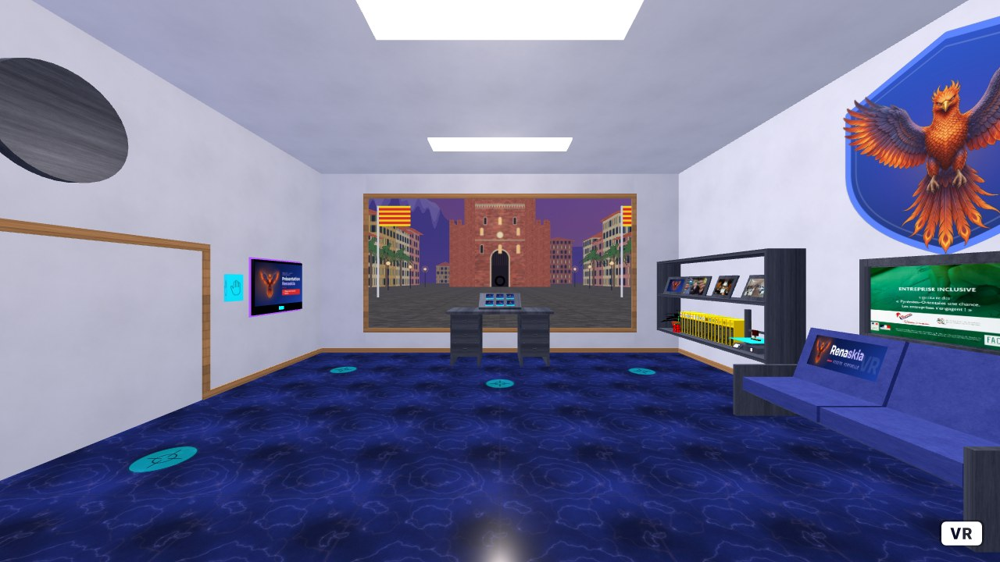

# Renaskia VR

Site VR de Renaskia (A-Frame) : formation, audit et cybersécurité.
Apprendre, renaître, avancer.

Pour tester en local, ne pas ouvrir `vr.html` directement (le navigateur bloque les modèles 3D en `file://`).
Lancer un petit serveur dans ce dossier : `python -m http.server 8000`, puis ouvrir http://localhost:8000/vr.html

Adapté du site VR Glorydev. Conception initiale : Ekleipsi Médias.
